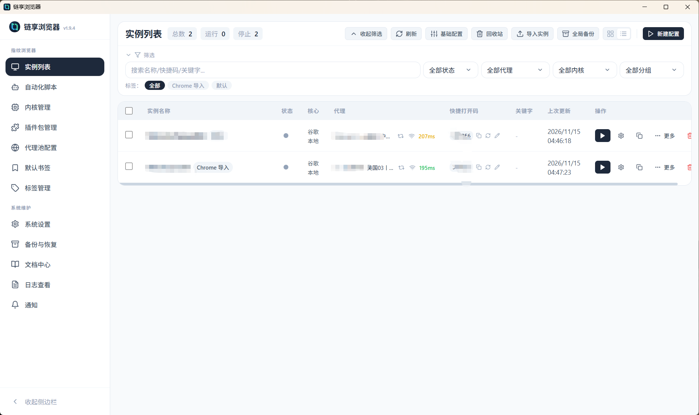
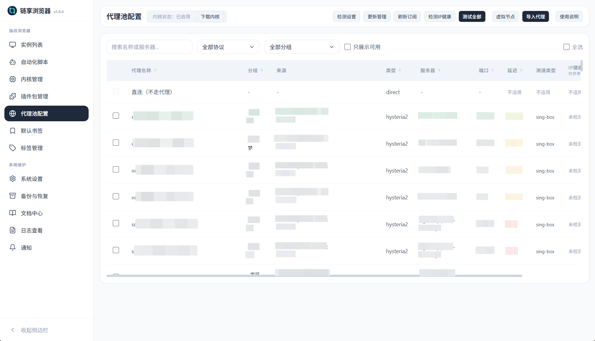
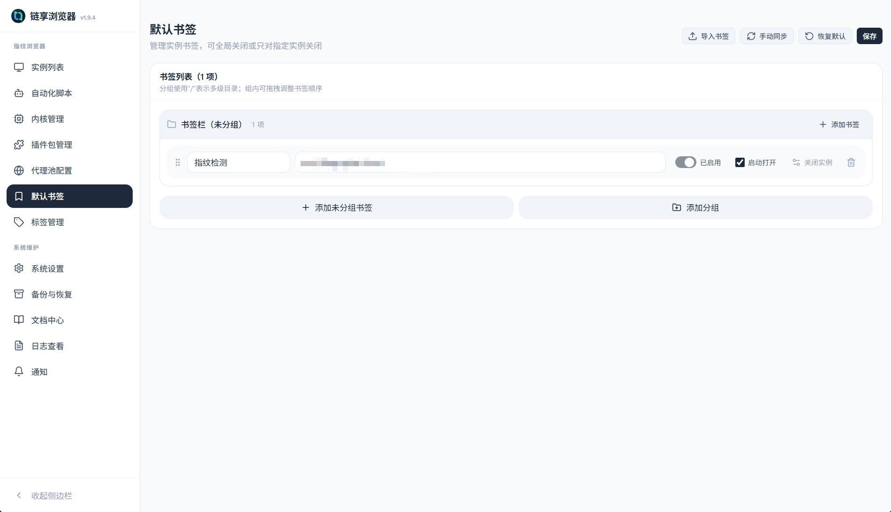
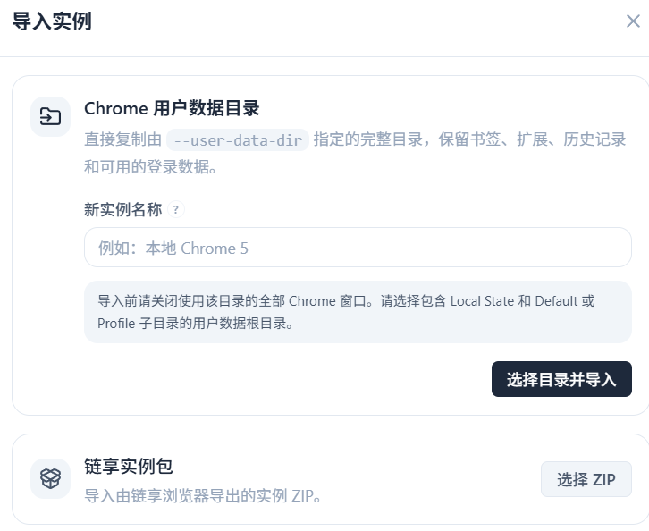

# 链享浏览器

在本地管理多个独立的 Chrome 浏览器环境，统一配置代理、内核、书签、插件和自动化任务。

**当前版本：v1.9.4 · 2026-11-15**

[下载发行版](https://github.com/wuyingzhishang/LianXiang-Browser/releases) · [v1.9.4 更新说明](RELEASE-NOTES-v1.9.4.md) · [更新日志](CHANGELOG.md) · [反馈问题](https://github.com/wuyingzhishang/LianXiang-Browser/issues)

## v1.9.4 更新

- **书签管理**：支持分组、排序、导入，以及全局或针对单个实例的启用控制。
- **导入 Chrome 本地多开数据**：把已有 `--user-data-dir` 复制为独立实例，保留源目录；导入前检查占用，自动跳过缓存和临时锁文件。
- **退出更顺畅**：启用 WebView2 默认 GPU 加速，简化弹窗动画，移除固定等待，让后台清理与界面响应分开执行。
- **接口兼容**：统一桌面命令、事件和窗口操作入口，保持原有参数、结果和错误语义。
- **Windows 发布集更新**：提供安装包、本地 EXE、便携 ZIP 和统一 SHA-256 校验文件。

本版继续使用 **Go + Wails + React**。Windows 前端通过系统 **WebView2** 渲染，没有切换到 Rust/Tauri，也没有更改数据库结构、配置格式或实例数据路径。

## 选择下载文件

本次发行提供 Windows x64 产物。Linux 和 macOS 的源码构建说明保留在仓库中，v1.9.4 本次未生成这两个平台的安装包。

| 文件 | 适合的用途 |
| --- | --- |
| `LianXiangBrowser-Setup-1.9.4.exe` | 常规安装或在原安装目录覆盖升级 |
| `LianXiangBrowser-1.9.4-windows-amd64-portable.zip` | 解压后运行，包含主程序、Xray、sing-box 和默认配置 |
| `LianXiangBrowser-1.9.4-windows-amd64.exe` | 单独的主程序，适合更新已有完整目录；不包含代理运行时和浏览器内核 |
| `SHA256SUMS.txt` | 核验以上三个文件是否与本次构建一致 |

程序需要 Microsoft Edge WebView2 Runtime。本次安装包和便携包**不包含 Chrome 内核或用户数据库**；首次使用时在“内核管理”中下载或导入兼容内核。推荐使用 [fingerprint-chromium](https://github.com/adryfish/fingerprint-chromium) 提供的内核，并遵守其许可证。

下载后可使用 PowerShell 核对文件：

```powershell
Get-FileHash .\LianXiangBrowser-Setup-1.9.4.exe -Algorithm SHA256
Get-Content .\SHA256SUMS.txt
```

## 快速开始

1. 安装程序，或将便携包解压到有写入权限的目录，运行 `lianxiang-browser.exe`。
2. 打开“内核管理”，下载或导入浏览器内核，并设置默认内核。
3. 如需代理，在“代理池配置”中新增或导入节点，按当前连接栈测试连通性。
4. 在“实例列表”中新建配置，选择名称、内核、代理和启动参数。
5. 启动实例。使用 `Ctrl + K` 可按名称、标签或快捷码查找并启动实例。

## 主要功能

| 功能 | 说明 |
| --- | --- |
| 实例管理 | 新建、配置、启动、停止、重启、克隆、回收与筛选 |
| 环境隔离 | 每个实例使用独立用户数据目录，可单独指定内核和代理 |
| 代理池 | 节点导入、分组、测速、真实连通性和 IP 健康检查 |
| 书签管理 | 分组、排序、导入、同步及实例范围控制 |
| Chrome 数据导入 | 将已有本地 Chrome 用户数据目录复制为新实例 |
| 插件管理 | 导入和维护插件包，设置启用范围与实例配置 |
| 自动化 | 导入脚本、选择目标实例、运行任务并查看执行记录 |
| 备份与恢复 | 本地、OpenList、S3；支持全量与选择性实例备份 |
| 快捷启动 | `Ctrl + K`、实例快捷码及本地启动接口 |

### 首页与实例列表

首页集中展示实例状态、内核、代理、快捷打开码和更新时间。可按名称、状态、代理、内核或分组筛选，直接启动、配置或克隆实例，也可从顶部导入已有实例。



### 代理池配置

在“代理池配置”中导入代理、刷新订阅，按协议和分组筛选节点，并查看延迟、测速类型和 IP 健康结果。截图中的 hysteria2 节点由 sing-box 处理；实际测速和连接遵循当前选择的[代理连接栈](#代理连接栈)。



### 默认书签与分组

在“默认书签”中添加书签或分组，分组名称可用 `/` 表示多级目录，组内支持拖拽排序。每条书签可设置是否启用、是否在实例启动时打开，以及对哪些实例关闭；修改后点击“保存”，也可导入书签或手动同步。



## 导入已有 Chrome 环境

在“实例列表 → 导入实例 → Chrome 用户数据目录”中选择“选择目录并导入”。可先填写导入后的实例名称。



导入窗口提供两种入口：“Chrome 用户数据目录”用于复制本地 Chrome 环境，保留书签、扩展、历史记录和可用的登录数据；“链享实例包”用于导入由链享浏览器导出的实例 ZIP。

选择的是包含 `Local State` 和 `Default` / `Profile *` 子目录的**用户数据根目录**，不是单独的 `Default` 文件夹。例如，原 Chrome 启动参数为：

```text
chrome.exe --user-data-dir="D:\ChromeProfiles\account-01"
```

则选择 `D:\ChromeProfiles\account-01`。导入前关闭所有使用该目录的 Chrome 窗口。程序会复制到新实例目录，跳过缓存、临时锁和符号链接；复制或保存失败时回滚新建内容。

Chrome 的登录凭据可能受 Windows 用户身份、浏览器版本和应用绑定加密限制。复制目录不保证跨机器或跨内核后仍保留全部登录状态。

## 数据与升级

实际数据位置以“系统设置”中的数据目录为准；安装目录和数据目录可能不同。配置、SQLite 数据库、浏览器用户数据及本地备份凭据仍沿用现有格式。

- **安装版升级**：正常退出应用后，在原安装路径覆盖安装，不需要先卸载。已有 `config.yaml` 和用户数据目录应保留。
- **更新已有便携目录**：退出应用后更新程序和运行时文件，保留自己的 `config.yaml`、数据目录选择配置及实例数据；不要用发行包默认配置覆盖个人配置。
- **全新使用**：发行包不携带用户数据库，首次运行会初始化本地数据。
- **备份**：升级前可通过“备份与恢复”生成备份；本次版本更新不要求执行数据迁移或重建实例。

OpenList Token、S3 访问凭据保存在本地 `backup.local.yaml`，不会写入普通 `config.yaml`。不要将凭据、用户数据库、浏览器目录或备份上传到公开仓库。制作发行包只使用发布模板和程序文件。

## 代理连接栈

`browser.default_connector_type` 决定连接栈，启动、测速、连通性、IP 健康检查、预热及代理下载均按此配置执行。

| 设置 | 执行方式 |
| --- | --- |
| `xray` | Xray + sing-box 组合栈：Xray 处理 vmess、vless、trojan、shadowsocks、链式代理等；sing-box 处理 hysteria2、tuic、anytls 等 |
| `mihomo` | 独立 Mihomo 栈；使用前需在应用中准备对应运行时 |

两套栈之间不会自动混用。切换栈后应重新测速；不要将 sing-box 负责的协议视为整个 `xray` 组合栈不支持。

## 常见问题

**主界面无法打开或出现空白？**

检查 WebView2 Runtime 是否安装完整。主界面与 Chrome 实例使用不同的运行环境：主界面由 WebView2 渲染，实例需要另外准备 Chrome 内核。

**实例启动失败？**

检查内核路径、数据目录写入权限和代理配置；在“日志查看”中查找失败原因。

**退出时应该选哪一个？**

“最小化到托盘”保持应用运行；“仅退出应用”保留正在运行的浏览器实例；“退出应用与浏览器”会等待浏览器和后台服务清理。清理耗时取决于实例数量及当时任务。

**旧显卡驱动与 GPU 加速不兼容？**

可在启动进程时设置 `LIANXIANG_WEBVIEW_DISABLE_GPU=1` 使用软件渲染。正常情况下保留默认设置即可。

## 开发与构建

Windows 开发需要 Go、Node.js/npm、Wails CLI 和 WebView2；制作安装包还需要 NSIS。依赖版本以 `go.mod`、`frontend/package-lock.json` 为准。桌面接口测试需要 Node 22.18+ 或 24+。

```powershell
# 开发启动
bat\dev.bat

# Windows v1.9.4 完整发布集
powershell -NoProfile -ExecutionPolicy Bypass -File bat\publish.ps1 `
  -Target WINDOWS -WindowsFormat BOTH -Version 1.9.4 `
  -OutputDirectory publish/output/v1.9.4
```

发布脚本保留既有输出目录中的数据，只清理本次创建的临时 staging。校验清单只收录本次生成的文件。完整流程见 [Windows 发布说明](docs/release-windows.md)。

- [开发脚本](bat/README.md)
- [构建与发布检查清单](docs/build-and-release-checklist.md)
- [Linux 构建](publish/linux/README.md)
- [macOS unsigned 构建](publish/mac/README.md)
- [桌面接口契约](frontend/src/desktop/README.md)

## 反馈、致谢与许可

提交 [Issue](https://github.com/wuyingzhishang/LianXiang-Browser/issues) 时，请提供应用版本、系统版本、复现步骤以及脱敏后的日志。欢迎通过 Pull Request 改进代码和文档。

感谢上游 [Ant-Browser](https://github.com/black-ant/Ant-Browser)、[fingerprint-chromium](https://github.com/adryfish/fingerprint-chromium)、Wails、Xray、sing-box、Mihomo 及相关社区项目。

源代码使用 [PolyForm Noncommercial License 1.0.0](LICENSE)，仅授权非商业用途。第三方依赖、运行时和浏览器内核分别遵循各自许可证。
